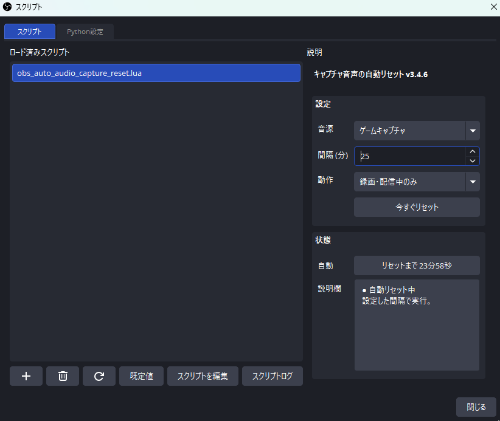
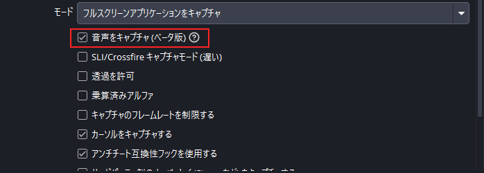

# キャプチャ音声の自動リセット

**v3.4.6｜OBSWindows版｜Luaスクリプト**  

  

指定した音声キャプチャを、定期的にリセットします。映像設定は変更しません。

## 1. 使い方

1. ZIPを解凍し、`obs_auto_audio_capture_reset.lua` をOBSの「ツール → スクリプト」から「＋」で追加します。
2. 「音源」「間隔 (分)」「動作」を設定します。
3. 必要に応じて「今すぐリセット」を使ってください。

  

**ゲーム／ウィンドウキャプチャ：** プロパティで「音声をキャプチャ（ベータ版）」をONにしてください。

  

## 2. 設定

- **音源：** リセット対象を1つ選択します。
- **間隔：** 1～1500分。自動動作開始から設定時間後に初回リセットします。
- **動作：** 「録画・配信中のみ」（初期値）／「常時、自動リセット」／「自動リセットしない」。
- **今すぐリセット：** 動作モードに関係なく実行します。自動実行中は成功後に間隔を数え直します。

## 3. 対応環境

- **Windows 10 バージョン2004以降／OBS Studio 29.1以降（64ビット）**。OBS 33.0.0で動作確認済みです。
- **対象：** アプリケーション音声・ゲーム・ウィンドウキャプチャ。マイクやデスクトップ音声は対象外です。
- 追加インストール不要。OBSの言語に応じて日本語／英語で表示します。

## 4. 確認・対処

- リセット時に短い音切れが発生する場合があります。録画で確認してください。
- **「音声キャプチャがOFF」：** 対象音源のプロパティで音声キャプチャをONにしてください。
- **「取り込み先が未設定」：** 対象ウィンドウを選択してください。
- **「この音源は使えません」：** 対応する音源を選び直してください。
- **「スクリプトログ参照」：** OBSの「ツール → スクリプト → スクリプトログ」を確認してください。
- **残り時間などが止まった場合：** スクリプト画面を開き直してください。自動リセットは継続します。

「リセットを要求しました」は再接続完了の確認ではありません。

## 5. 更新・注意

- **更新：** 録画・配信を止め、Luaファイルを上書きして「再読み込み」を押してください。
- **削除：** スクリプト一覧から削除し、Luaファイルも削除してください。
- 設定はシーンコレクションごとに保存されます。同じ音源に本スクリプトを重複登録しないでください。
- OBSとQtの内部機能に依存します。OBS更新後は動作を確認してください。

## ライセンス

[MIT License](LICENSE)です。使用・改造・再配布・商用利用が可能です。再配布時は著作権表示とライセンス本文を残してください。OBS Projectの公式配布物ではなく、無保証です。
